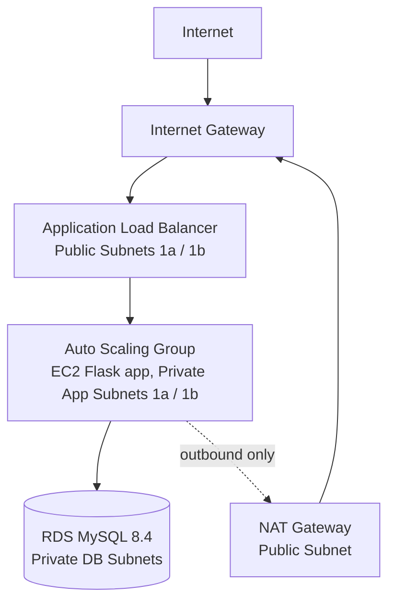
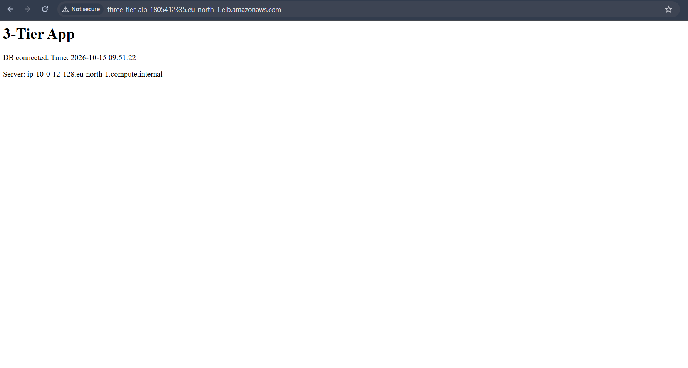
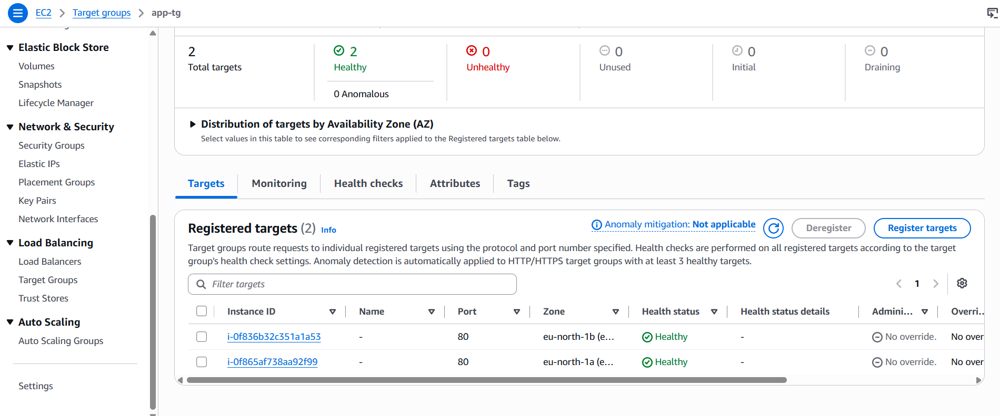
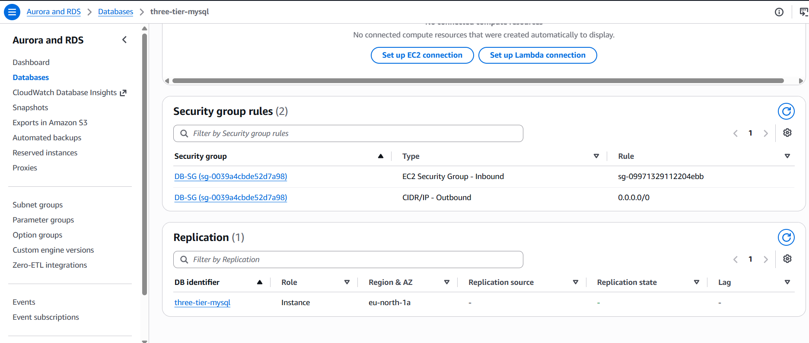
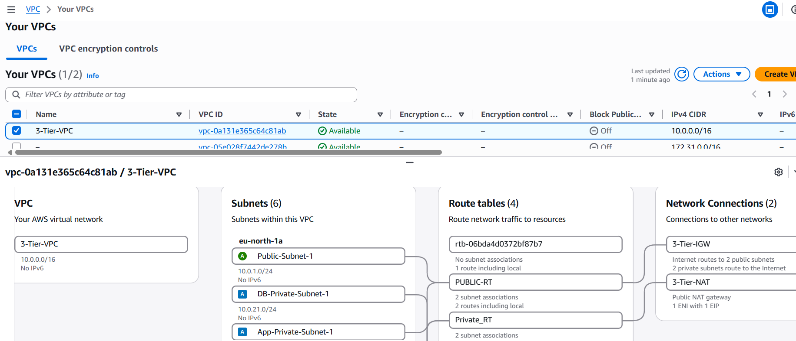

# 3-Tier Web Architecture on AWS

A highly available, secure 3-tier architecture built manually from the AWS Console in `eu-north-1` (Stockholm).

## Architecture



| Tier | Component | Subnet |
|---|---|---|
| Web | Application Load Balancer, NAT Gateway | Public (2 AZs) |
| App | EC2 instances (Auto Scaling Group, min 2 / max 3) | Private (2 AZs) |
| Database | RDS MySQL (`db.t3.micro`, single-AZ, encrypted) | Private (2 AZs) |

**VPC:** `10.0.0.0/16` with 6 subnets (2 public, 2 app-private, 2 db-private), Internet Gateway, NAT Gateway, and separate public/private route tables.

## Security Chain

```
Internet -> ALB-SG (80) -> App-SG (80, source: ALB-SG only) -> DB-SG (3306, source: App-SG only)
```

- No SSH rule exists in any security group and no bastion host is used.
- App servers are managed through **AWS Systems Manager Session Manager** (IAM role `AmazonSSMManagedInstanceCore`).
- The database is not publicly accessible and is reachable only from the App tier.
- App servers have no public IPs; outbound internet access goes through the NAT Gateway.

## How It Works

- **Launch Template** with a User Data script ([`user-data.sh`](user-data.sh)) installs Flask and PyMySQL and runs the app as a `systemd` service, so instances configure themselves on boot.
- **Auto Scaling Group** keeps 2 healthy instances across 2 AZs and replaces failed ones.
- **Target Group** health check hits `/health`, which deliberately does not depend on the database, so a temporary DB issue does not mark every instance unhealthy.
- The `/` endpoint queries the database and shows the serving instance name, proving the full ALB -> App -> DB path.

## Verification

Screenshots are in [`screenshots/`](screenshots/).

- Working site through the ALB DNS name, showing `DB connected`
- Target Group `app-tg`: 2 healthy targets in different AZs
- RDS security group rule: inbound 3306 only from App-SG
- VPC resource map: subnets, route tables, IGW, NAT

### Working site


### Target Group


### RDS Security Group


### VPC Resource Map


## Troubleshooting Notes

- Session Manager showed "Not connected" until the IAM role was attached and the instance was rebooted.
- Browser could not resolve the new ALB DNS name for a few minutes after creation (`DNS_PROBE_FINISHED_NXDOMAIN`); it worked once DNS propagated.
- Pasting multi-line commands into the Session Manager terminal added stray characters; a single-line command avoided it.

## Limitations and Improvements

- The DB password is stored in plain text in the Launch Template User Data (acceptable for a lab). In production, use **AWS Secrets Manager** with an IAM role.
- The ALB listens on HTTP only. Production would use HTTPS with an ACM certificate.
- RDS is single-AZ to save cost. Production would use Multi-AZ.
- Flask's development server is used. Production would use gunicorn or similar.
- Infrastructure was built by hand; next step is to codify it in Terraform or CloudFormation.

## Cost Note

NAT Gateway, ALB and RDS are billed hourly. All resources were deleted after testing.
